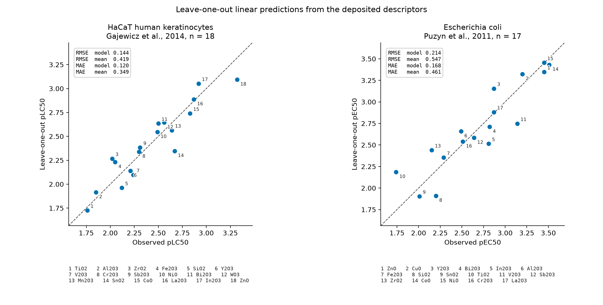

# Metal-oxide cytotoxicity on two published nano-QSAR tables

[](LICENSE)


Learning project. Two small, published metal-oxide tables are reanalysed with leave-one-out linear regression. The question is whether the descriptors deposited with those tables predict cytotoxicity better than predicting the mean, when each oxide is held out in turn.

The measured endpoint is not an input. An earlier draft of this repository scored eight illustrative rows with a weighted sum that included cell viability. Those rows had no stated source, and the score used the outcome itself. Both are gone.

## Question

For the metal oxides in the Gajewicz et al. (2014) HaCaT table and the Puzyn et al. (2011) *Escherichia coli* table, is the leave-one-out error of a linear model on the deposited descriptors smaller than the leave-one-out error of the mean endpoint?

## Data

Both files are QsarDB archives (CC BY 4.0). `python main.py` downloads them into `data/cache/` and checks the SHA-256 values stored in `src/nanotoxicity/datasets.py`. The archives are not committed.

### HaCaT keratinocytes

Gajewicz, A., Schaeublin, N., Rasulev, B., Hussain, S., Leszczynska, D., Puzyn, T., and Leszczynski, J. Towards understanding mechanisms governing cytotoxicity of metal oxides nanoparticles: Hints from nano-QSAR studies. *Nanotoxicology* 9(3):313–325, 2014. https://doi.org/10.3109/17435390.2014.930195

Piir, G. Data for: Towards understanding mechanisms governing cytotoxicity of metal oxides nanoparticles: Hints from nano-QSAR studies. QsarDB repository, QDB.214, 2020. https://doi.org/10.15152/QDB.214

- 18 metal oxides with a measured endpoint. The archive names it pLC50: log(1/LC50) for the HaCaT human keratinocyte line, with LC50 in mol/L.
- Two descriptors, both recorded as MOPAC 2009 calculations: standard enthalpy of formation of the metal-oxide nanocluster (`dH-fc`, kcal/mol) and Mulliken electronegativity (`Xc`, eV).
- Five further oxides, archive ids `P_1` to `P_5`, have descriptors and no measured pLC50. They are not fitted and not scored.

### *Escherichia coli*

Puzyn, T., Rasulev, B., Gajewicz, A., Hu, X., Dasari, T. P., Michalkova, A., Hwang, H.-M., Toropov, A., Leszczynska, D., and Leszczynski, J. Using nano-QSAR to predict the cytotoxicity of metal oxide nanoparticles. *Nature Nanotechnology* 6(3):175–178, 2011. https://doi.org/10.1038/nnano.2011.10

Piir, G. Data for: Using nano-QSAR to predict the cytotoxicity of metal oxide nanoparticles. QsarDB repository, QDB.119, 2014. https://doi.org/10.15152/QDB.119

- 17 metal oxides with a measured endpoint. The archive names it pEC50: log(1/EC50) for *E. coli*, with EC50 in mol/L.
- One descriptor, recorded as a MOPAC 2009 calculation: the enthalpy of formation of a gaseous cation (`dH_Me`, kcal/mol).
- The archive marks some oxides as training or external-validation compounds. Those marks are not used. Every oxide with a measured endpoint enters the leave-one-out loop.

## Methods

For each table, separately:

1. Keep a compound only when the endpoint and every deposited descriptor are present.
2. Leave-one-out cross-validation. The model for a held-out oxide is ordinary least squares fit on the other oxides. Descriptors are standardized with the mean and standard deviation of those training rows. For least squares this does not change the predictions. It puts the separate full-sample coefficients into standard-deviation units.
3. Baseline: the prediction for a held-out oxide is the mean endpoint of the other oxides.
4. RMSE, MAE, and R² are computed on the held-out predictions.

No descriptor was added or removed. This reanalysis does not search over other descriptors, and it does not repeat fit statistics from the source papers. The full-sample coefficients in `results/metrics.json` are descriptive. They are not a cross-validated performance measure.

## Quickstart

From a fresh clone, using Python 3.10 or newer:

```bash
python -m venv .venv
source .venv/bin/activate
python -m pip install -r requirements.txt
python main.py
```

`python main.py` downloads the archives and rewrites `results/`. With the pinned dependencies and the pinned archive checksums, that run reproduces `results/metrics.json`.

Tests and lint:

```bash
python -m pip install -r requirements-dev.txt
ruff check src tests main.py
pytest
```

## Results

The numbers below come from one run of `python main.py`. They are rounded to three decimal places from `results/metrics.json`. R² for the baseline is slightly negative because each baseline prediction is the mean of the other rows, which is a worse constant than the mean of every row.

| Table | n | Model RMSE | Mean RMSE | Model MAE | Mean MAE | Model R² | Mean R² |
| --- | ---: | ---: | ---: | ---: | ---: | ---: | ---: |
| Gajewicz, HaCaT | 18 | 0.144 | 0.419 | 0.120 | 0.349 | 0.868 | −0.121 |
| Puzyn, *E. coli* | 17 | 0.214 | 0.547 | 0.168 | 0.461 | 0.827 | −0.129 |



*Observed endpoint against the leave-one-out linear prediction. The dashed line is equality. Numbers match the oxide key under each panel, in archive order. The box gives leave-one-out RMSE and MAE for the linear model and for the mean of the other rows, from the same run as the table.*

On these oxides, the deposited descriptors have a smaller leave-one-out error than the mean. That comparison does not extend, by itself, past these two tables.

Full-sample slopes from the same run, in endpoint units per one standard deviation of the descriptor:

- HaCaT: `dH-fc` 0.209, `Xc` 0.344. The intercept, which is the mean pLC50, is 2.426.
- *E. coli*: `dH_Me` −0.478. The intercept, the mean pEC50, is 2.715.

The negative `dH_Me` slope means that, in this fit, a higher enthalpy of formation of the gaseous cation goes with a lower pEC50. These slopes were fit on all labelled rows. They were not cross-validated.

Held-out predictions for every labelled oxide are in `results/loocv_predictions.csv`.

## Limitations

- Seventeen and eighteen oxides cannot support a general cytotoxicity model. Both tables contain only metal oxides, and each table is one biological system.
- The descriptors are the ones deposited with the original models, so they were already chosen for these endpoints. Leave-one-out error given that choice is not the error of a model whose descriptors were selected on other data.
- The descriptors are quantum-chemical values calculated by the original authors. This repository does not recompute them. Measured particle size, zeta potential, surface area, and dose are not columns in these archives, so they are not in the model.
- The five unlabelled Gajewicz oxides are not an external test. The archive does not give a pLC50 to compare with.
- Both endpoints are log-transformed reciprocal concentrations from the source experiments. They are not percent cell viability, and they are not a clinical outcome.
- A linear model with one or two coefficients can look stable under leave-one-out and still fail for another cell type, another dose, or another class of nanomaterial. These archives do not contain that test.
- This is a learning project. It is not a regulatory assessment, and it does not rank materials for use.

## Repository layout

```text
src/nanotoxicity/    archive download, parser, leave-one-out model, figure
main.py              runs the analysis from a clone
tests/               parser, model, and a check that the reported metrics match a refit
results/             metrics, held-out predictions, figure
```

## Citation

Software: `CITATION.cff`. The data citations are the four sources in the Data section. Those datasets are CC BY 4.0. The code is MIT.

## Author

**Ishitta Sarkar** · [ORCID](https://orcid.org/0009-0008-1028-6010)

M.Tech in Bioinformatics (in progress, expected 2028). B.Tech Biotechnology (Honours), Dr. A.P.J. Abdul Kalam Technical University, 2022–2026.
